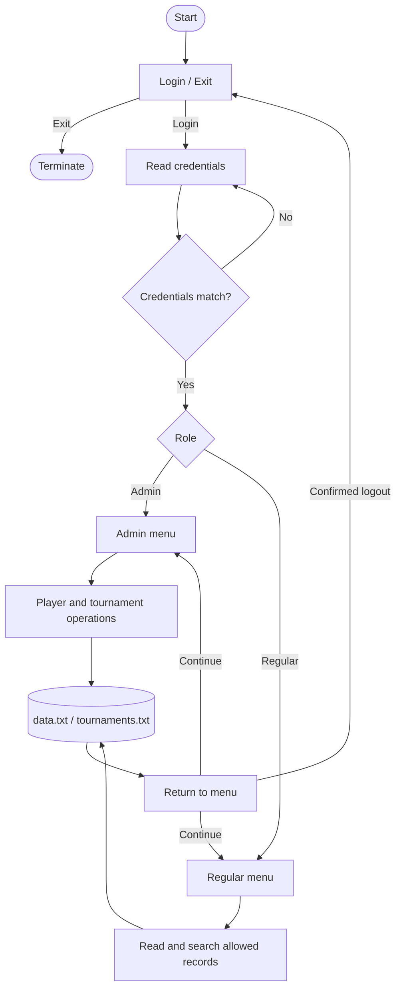
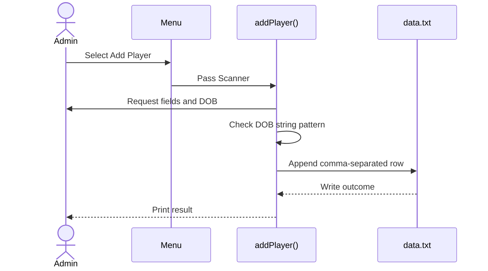

# ♟️ Chess Academy Management System (Java)

<p align="center"></p>
<p align="center"><strong>A role-based Java console application for maintaining chess player records and tournament listings.</strong></p>
<p align="center">  </p>

> [!IMPORTANT]
> This is a single-file Java console application. It does not implement a web interface, database, network service, chess engine, online matchmaking, payment processing, or persistent account management.

## 📚 Contents
- [Overview](#-overview)
- [Implemented capabilities](#-implemented-capabilities)
- [Roles and permissions](#-roles-and-permissions)
- [Architecture](#-architecture)
- [Data files](#️-data-files-and-formats)
- [Setup](#-requirements-and-run-locally)
- [Testing](#-testing-and-verification)
- [Security](#-security-considerations)
- [Limitations](#️-known-limitations)
- [Roadmap](#️-roadmap)
- [Documentation](#-documentation)

## 🎯 Overview
A terminal-based Java program for maintaining basic chess-academy player records and tournament listings. It uses hard-coded example credentials, role-specific menus, and append-only local text files. It is a learning-oriented foundation, not production-ready.

## ✨ Implemented capabilities
| Capability | Current behavior | Access |
|---|---|---|
| Login | Checks credentials against in-source array | Both configured accounts |
| Add player | Appends registration number, names, DOB and rating to `data.txt` | Admin |
| Display players | Prints `data.txt` records | Both |
| Search player | Prefix search by registration number | Admin menu |
| Add tournament | Appends name, date and location to `tournaments.txt` | Admin |
| Display tournaments | Prints tournament records | Both |
| Search tournament | Prefix search by name | Both |
| Help / logout | Role-dependent help and confirmation | Both |

### Admin menu
1. Add player, 2. Display players, 3. Search players, 4. Add tournament, 5. Display tournaments, 6. Search tournaments, 7. Help, 8. Logout.

### Regular menu
2. Display players, 5. Display tournaments, 6. Search tournaments, 7. Help, 8. Logout.

## 👥 Roles and permissions
| Operation | Admin | Regular |
|---|:---:|:---:|
| Add player | ✅ | ❌ |
| Display players | ✅ | ✅ |
| Search players | ✅ | ❌ |
| Add tournament | ✅ | ❌ |
| Display tournaments | ✅ | ✅ |
| Search tournaments | ✅ | ✅ |
| Help and logout | ✅ | ✅ |

## 🏗️ Architecture
The application is a single Java class with static methods. There is no package hierarchy, service layer, repository abstraction, API, or database.



## 🔄 Player registration sequence


## 🗂️ Data files and formats
Player row in `data.txt`:
```text
registrationNumber,firstName,lastName,DD/MM/YYYY,rating
CH-001,Aarav,Sharma,15/04/2008,1200
```
Tournament row in `tournaments.txt`:
```text
tournamentName,DD/MM/YYYY,location
City Open,20/12/2026,Community Chess Hall
```
Examples are synthetic. The program does not escape commas, enforce uniqueness, validate real calendar dates, or recover structurally from malformed rows. Files are relative to the process working directory.

## ⚙️ Requirements and run locally
- JDK providing `javac` and `java`.
- Terminal and read/write access to the working directory.

```bash
git clone https://github.com/Brajesh31/ChessAcademySystem_Java.git
cd ChessAcademySystem_Java
javac -Xlint:all chessAcademy.java
java chessAcademy
```

No third-party Java dependencies, Maven or Gradle files are currently declared.

## 🧪 Testing and verification
No Java unit-test framework was present at inspection. CI will compile the source and validate documentation/repository structure. Compilation does not prove all interactive paths work. See [testing strategy](docs/testing.md).

## 🔐 Security considerations
Credentials are hard-coded in plaintext in Java source; records are plaintext local files. There is no hashing, account provisioning, lockout, encryption, audit log, or secure authorization boundary. Use synthetic records only. See [security](docs/security.md) and [threat model](docs/threat-model.md).

## ⚠️ Known limitations
1. Plaintext credentials embedded in source.
2. Date validation checks shape only.
3. Delimited fields are not escaped.
4. No update/delete operations or duplicate detection.
5. File read errors are reported generically.
6. Non-numeric menu input is not handled as robustly as login input.
7. Regular-user help mentions player search, but the regular menu does not offer it.
8. No automated Java unit tests.
9. No database, API, GUI, or network functionality.

## 🛣️ Roadmap
These are proposals, not implemented features:
- [ ] Extract Player and Tournament models and storage responsibilities.
- [ ] Add calendar-date and rating validation.
- [ ] Correct menu input recovery and help/menu mismatch.
- [ ] Replace plaintext credentials with secure handling.
- [ ] Add parser tests, duplicate detection and safe file format handling.
- [ ] Add automated tests for role access and file operations.
- [ ] Add controlled update/delete and backup/restore operations.
- [ ] Evaluate database storage only when shared usage requires it.

## 📖 Documentation
| Document | Purpose |
|---|---|
| [Index](docs/README.md) | All project guides |
| [Product overview](docs/product-overview.md) | Scope, users and capabilities |
| [Requirements](docs/requirements.md) | Requirements and use cases |
| [Architecture](docs/architecture.md) | Current system boundaries |
| [Project structure](docs/project-structure.md) | Tree and file roles |
| [Data formats](docs/data-formats.md) | Text persistence |
| [Development](docs/development.md) | Setup and workflow |
| [Testing](docs/testing.md) | Manual and CI checks |
| [Security](docs/security.md) | Risks and safeguards |
| [Troubleshooting](docs/troubleshooting.md) | Common problems |
| [Templates](docs/templates/README.md) | Reusable templates |

## 🤝 Contributing
Read [CONTRIBUTING.md](CONTRIBUTING.md), follow the [Code of Conduct](CODE_OF_CONDUCT.md), and use the issue templates. Do not submit real player data or credentials.

## 📄 License
See [LICENSE](LICENSE).

<p align="center">Made with ♟️ and Java</p>

Last updated: 2026-11-17 11:24 UTC
