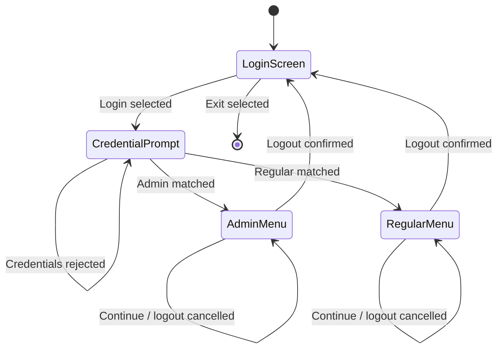

# 🔄 Application lifecycle

## Startup and login
1. JVM invokes `main`.
2. Scanner reads standard input.
3. Login/Exit screen appears.
4. Login calls `login`.
5. Input is compared to in-source credentials.
6. Matching role is passed to `displayMenu`; invalid credentials repeat.

## State diagram

## Storage lifecycle
Adds open files in append mode. Display/search read line by line. Resources use try-with-resources. No multi-file transaction, locking, backup or concurrency coordination exists.

## Error paths
I/O errors are printed generically. DOB is checked by regex. Login input catches exceptions, but menu numeric parsing lacks equivalent recovery.
