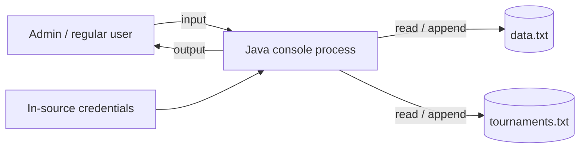
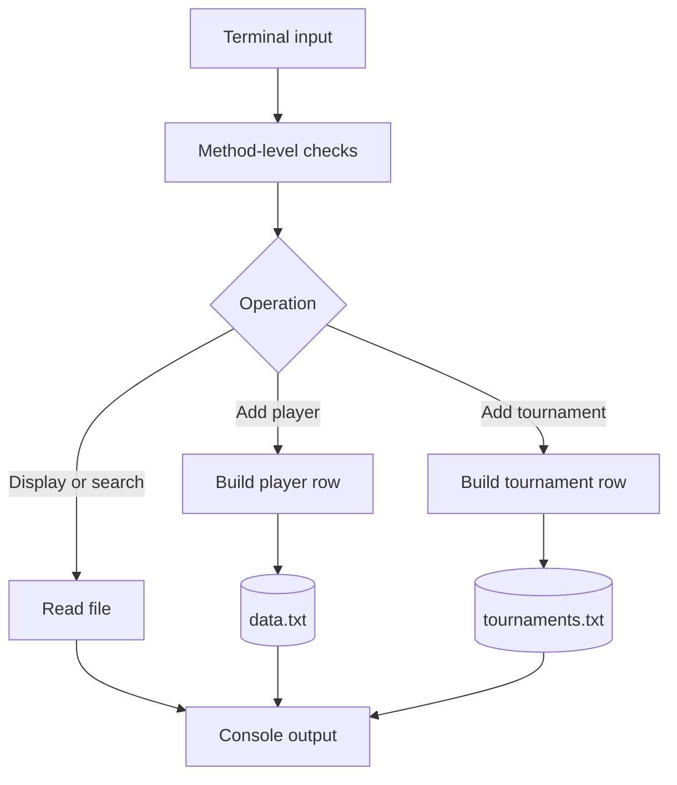

# 🏗️ Architecture

## Style
Single-process, single-class procedural console program. UI, domain rules, role checks and persistence remain coupled.

## Runtime components
| Component | Responsibility | Boundary |
|---|---|---|
| Console entry | Login/exit loop | Standard input/output |
| Credential table | Example accounts and roles | In-memory constant |
| Menu dispatcher | Role menu and action dispatch | Static methods |
| Player operations | Append, list and search | `data.txt` |
| Tournament operations | Append, list and search | `tournaments.txt` |
| Help/logout | Display help and return to login | Console |

## Context diagram

## Data flow

## Trust boundaries
The process trusts local input, source-controlled credentials, working directory, and local text files. No network boundary, encrypted store or backend exists.

Do not describe this as microservices, client-server, layered, or database-backed architecture. Introduce future abstractions only with real behavior and tests.
