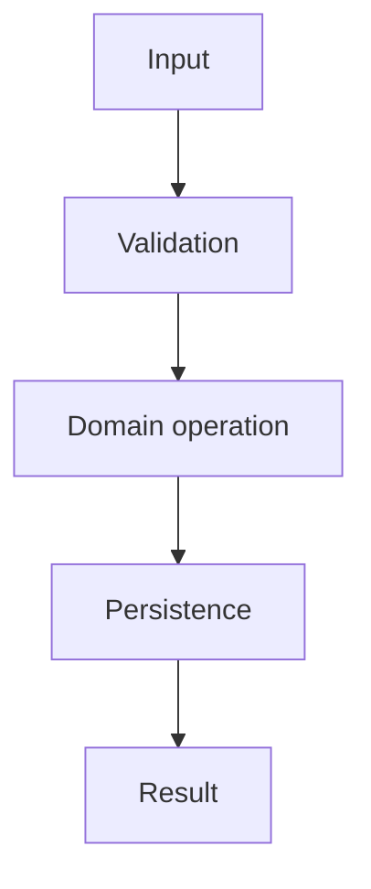

# 🏗️ Technical design: [Change]

## Context and constraints
[Current behavior, repository structure and constraints.]

## Goals and non-goals
[What this design will and will not deliver.]

## Proposed design
[Describe classes, responsibilities, call sequence and interfaces.]

## Architecture diagram

## Data model and format
[Schema, validation, encoding, migration and compatibility.]

## Failure modes
| Failure | Detection | User-visible result | Recovery |
|---|---|---|---|
| [Failure] | [How] | [Message] | [Action] |

## Security and privacy
[Trust boundaries, access control, secret handling and data minimization.]

## Testing
[Unit, integration, manual and regression evidence.]

## Alternatives considered
[Options and reasons rejected.]

## Rollout and rollback
[Safe sequence and recovery steps.]

## Risks and unresolved decisions
[Owner and next action.]
